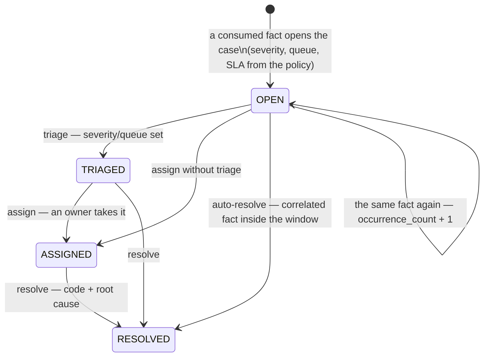

# The Problem Solve lifecycle

One lifecycle, four statuses, one terminal state. Every transition is an operator (or `system`)
action recorded in the case's audit trail, and every accepted transition publishes a domain event
([event catalogue](/docs/api-reference/events)).

## Open (from a fact, never a form)

A consumer deduplicates the fact on the CloudEvents `id` and the case on the dedup key
`(source_type, source_subject, site_id)` ([ADR 0002](/docs/adr/0002-aggregates-and-policy)):

- First occurrence → **open**: severity, queue and `sla_minutes` come from the current
  `ExceptionPolicy` version for that source type; the opening payload is **frozen** onto the case
  (`source_payload`) — the evidence chain.
- Repeat occurrence → **touch**: `occurrence_count + 1`, `last_seen_at` moved. This is why a CPT
  miss that re-fires on every sweep tick is one case getting louder, not N cases.
- A fact for a source type with no declared policy is skipped (WARN, commit past) — that is a
  configuration gap, not an incident.

There is no `POST /exceptions` — the REST surface answers 405 with the reason
([ADR 0001](/docs/adr/0001-exception-management-bounded-context)).

## The SLA clock

`sla_due_at = opened_at + policy.sla_minutes`. A bounded sweeper ticks
(`SLA_SWEEP_INTERVAL`, default 1m), escalates open cases past their due time and publishes
`ExceptionEscalated`. Escalation changes visibility, never state — a solved-late case is still
solved.

## Resolve (two ways)

- **Human**: `POST /exceptions/{caseId}/resolve` with a `resolutionCode`, a `rootCause` and an
  optional note. The actor is recorded.
- **Auto**: a policy's `auto_resolve` rule — `{on_type, within_minutes}` — fires when the
  correlated type arrives within the window of the case's `last_seen_at` (edge inclusive). The
  flagship rule: `OrderRepromised` auto-resolves the `TaskCPTMissed` case of the same order —
  correlation is order-level, and the rule id is the deterministic
  `<sourceType>-><onType>` ([ADR 0004](/docs/adr/0004-cloudevents-envelope-and-type-catalogue)).

Resolution is terminal. A source fact arriving afterwards **touches** the case (occurrence + 1)
and never reopens it — v1 has no reopen.

## What the operation reads

- Queues: every case sits in exactly one policy queue (`cpt-missed`, `count-discrepancy`, …) —
  `GET /exceptions?queue=…` is the queue view; `status`, `site`, `sourceType` filter too.
- The SLA report is the read behind the MCP tool `get_sla_report` (open, breached and escalated
  counts, by severity and by queue) — there is deliberately no REST path for it; REST serves
  case-level reads.

For the agent-facing read surface see [MCP tools](/docs/mcp/tools).
