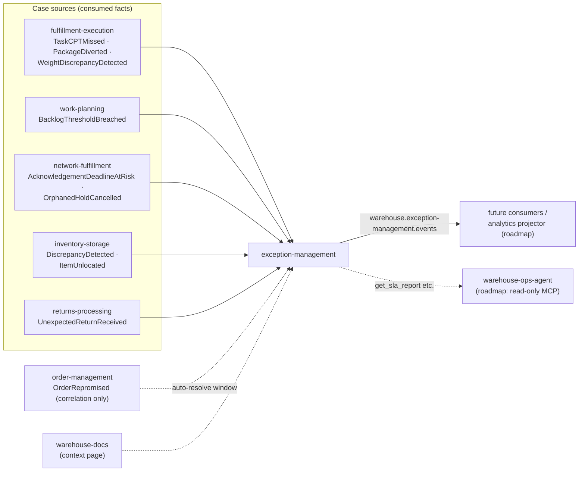

# Ecosystem integration

How exception-management plugs into the warehouse-systems fleet. The one rule that shapes all of
it: **it never calls a sibling context over REST or MCP** — facts in on Kafka, lifecycle out on
Kafka, reads over its own REST/MCP surfaces.

## Upstream (facts consumed)

Every producer owns its topic and its AsyncAPI; this context verifies the types against the
producers' `origin/develop` before consuming (the pinned table is the
[event catalogue](/docs/api-reference/events)). Notable mechanics:

- **Promoted types**: `PackageDiverted`, `WeightDiscrepancyDetected` (fulfillment-execution,
  PR #234) and `DiscrepancyDetected`, `ItemUnlocated` (inventory-storage, PR #239) were promoted to
  the integration topics for this context.
- **Re-firing sources**: `TaskCPTMissed` re-fires on every sweep tick by design — the dedup key
  makes it one case with a growing `occurrence_count`, and the re-fire keeps `last_seen_at` fresh,
  which the auto-resolve window uses.
- **Roadmap sources**: workforce-management `PathUnderstaffed` and network-inventory-planning
  `TransferStuckDetected` sit on analytics topics today; consumption starts when the producers
  promote them.

## Downstream (lifecycle published)

`warehouse.exception-management.events` carries the case lifecycle
([catalogue](/docs/api-reference/events)). Today the topic's consumers are analytics-inclined
future work — the **analytics projector is roadmap, not built** — but the contract is stable and
versioned: a `TeamPerformance`-style context or a warehouse console queue view can subscribe
without this service changing.

## Agent ecosystem

The read-only [MCP tools](/docs/mcp/tools) exist for `warehouse-ops-agent`, whose design keeps it
zero-write: it reads the SLA report and the queues, and an operator (through the console) or a
policy (auto-resolve) does the writing. The agent-side wiring is roadmap.

## Fleet documentation

`warehouse-docs` carries the cross-context narrative (the context map and the
[Core Domain Chart](/docs/ddd/core-domain-chart) mirror it); this site is the per-context
authority. The fleet plan lives in `.hermes/plans/` of the warehouse-systems checkout.
