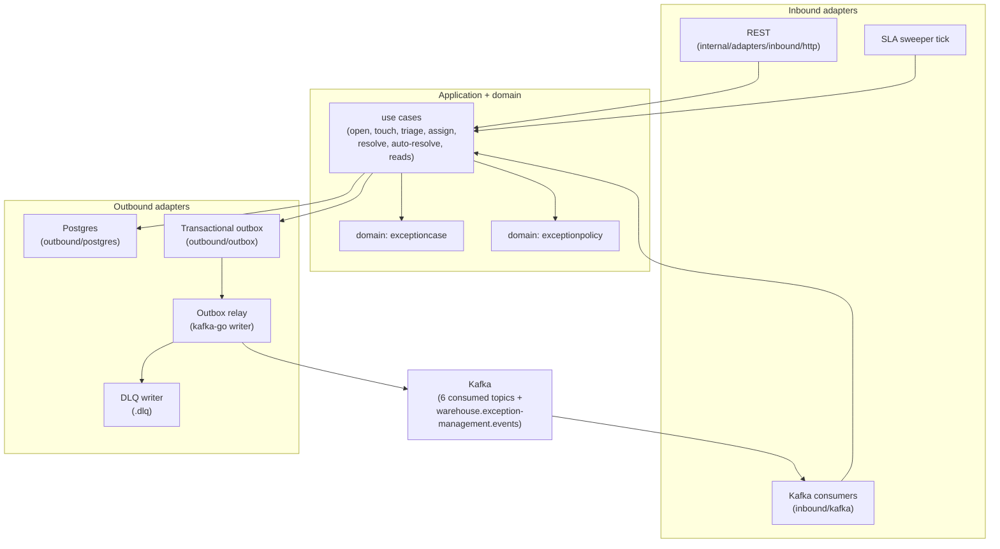

# Architecture

Hexagonal (ports and adapters), one aggregate cluster per domain package, everything else an
adapter. Only `cmd/` wires; the domain imports nothing internal but the domain
([ADR 0002](/docs/adr/0002-aggregates-and-policy)). The runtime is **real Postgres and real Kafka
only** — there is no in-memory mode — and there is **no auth middleware** (a fleet-wide decision of
2026-09-11; a fitness test fails CI if it returns).

## Aggregates

Two, in separate domain packages ([ADR 0002](/docs/adr/0002-aggregates-and-policy)):

- **`ExceptionCase`** — the Problem Solve case. Identity `case-<uuid>`; the *dedup key*
  `(source_type, source_subject, site_id)` collapses repeated facts into one case (open vs touch).
  Statuses `OPEN → TRIAGED → ASSIGNED → RESOLVED`, plus the `escalated` flag the SLA sweeper sets.
  Terminal: a fact arriving after resolution touches the case (`occurrence_count + 1`,
  `last_seen_at`), it never reopens — there is no reopen in v1.
- **`ExceptionPolicy`** — one per source type, append-only versions: severity, queue, `sla_minutes`
  and the optional `auto_resolve {on_type, within_minutes}` rule.

## Flow of a fact

1. A consumer on one of the six pinned consumer groups reads a CloudEvent, dedupes on the
   CloudEvents `id` in the same transaction as the effect, and commits the offset only after
   success ([ADR 0003](/docs/adr/0003-local-copies-and-consumed-contracts)).
2. An unknown fact type for a declared source opens a case; a repeat **touches** it.
3. Every state change is persisted **and** enqueued in the outbox in the same database transaction
   — the relay publishes it afterwards
   ([ADR 0005](/docs/adr/0005-outbox-relay-attempt-cap-and-dlq)). Nothing is published from a
   handler directly.
4. The correlation consumer watches `OrderRepromised`; when it lands inside an auto-resolve window
   of an open case of the matching order, the rule fires (`ExceptionAutoResolved`).

## Binaries

| Binary | Serves | Never does |
| --- | --- | --- |
| `cmd/api` | REST `:8080`, the six fact consumers, the correlation consumer, the SLA sweeper, the outbox relay | — |
| `cmd/mcp` | read-only MCP over Streamable HTTP `:8090` (`/mcp`, `GET /healthz`) | never writes, never dials Kafka, never runs the relay or the sweeper |
| `cmd/a2a` | read-only A2A agent, JSON-RPC over HTTP `:8093` (`/`, `/a2a`, the card at `/.well-known/agent-card.json`, `GET /healthz`) | never writes, never dials Kafka, never runs the relay or the sweeper |

The [generated REST reference](/docs/api-reference) and the [MCP tools page](/docs/mcp/tools)
document the REST and MCP surfaces; the A2A agent is described in [ADR 0007](/docs/adr/0007-a2a-inbound-adapter). The `internal/adapters/outbound/memory` package exists for tests only;
a shipped `cmd/**` binary never imports it (a fitness test enforces it).
