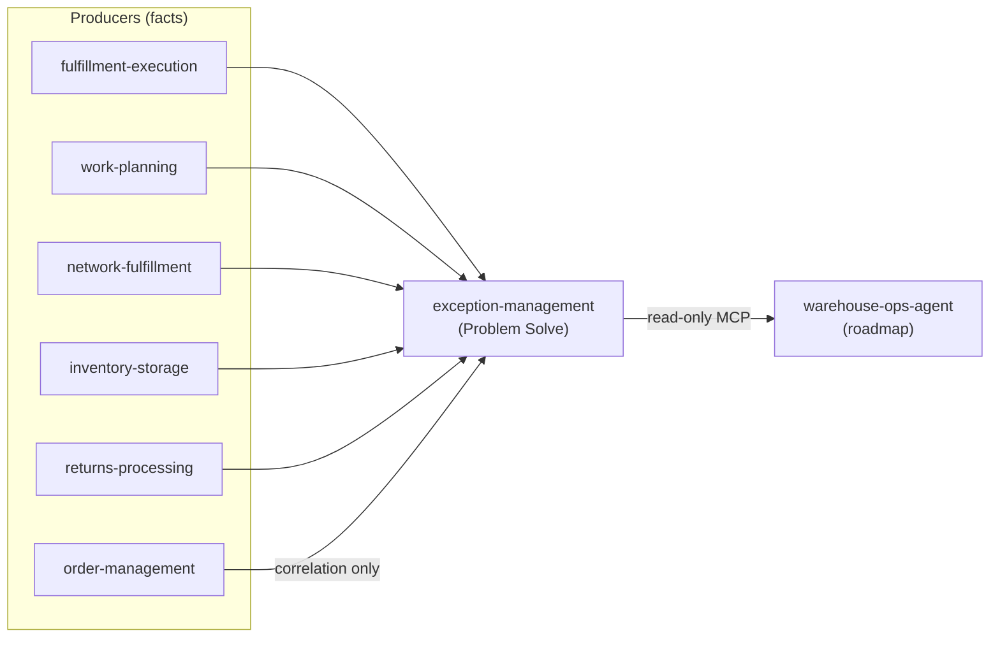

# Exception Management

`exception-management` is the bounded context that owns **Problem Solve**: the place where the
anomaly facts other contexts already publish become **owned cases**. A missed CPT, a breached
backlog threshold, an at-risk network acknowledgement, a count discrepancy, a diverted package, an
unexpected return — each is a *fact* on a Kafka topic. This context consumes those facts, opens
exactly one case per problem, and runs the case through triage, assignment, an SLA clock and
resolution with a recorded root cause. It is a **WES-tier Supporting** context: it never fixes the
anomaly itself; it makes sure no anomaly is invisible, unowned or unmeasured.

- Cases are opened **only** from consumed facts — there is deliberately no `POST /exceptions`
  ([ADR 0001](/docs/adr/0001-exception-management-bounded-context)).
- Operators triage, assign and resolve over REST; every accepted transition records its actor.
- A versioned `ExceptionPolicy` per source type sets severity, queue, SLA minutes and an optional
  **auto-resolve** rule (for example: an `OrderRepromised` fact closes the `TaskCPTMissed` case of
  the same work unit within its window).
- A bounded sweeper flags SLA breaches (`ExceptionEscalated`) without ever blocking work.
- Case facts leave through a transactional outbox as CloudEvents 1.0; the
  [event catalogue](/docs/api-reference/events) is the summary.
- A **read-only** MCP server (`cmd/mcp`, default off in the chart) exposes the caseload to
  warehouse-ops-agent — see [MCP tools](/docs/mcp/tools).

## Where it sits

It consumes nine case sources across five sibling topics plus one correlation fact, and publishes
its own case lifecycle on `warehouse.exception-management.events`:

The full consumed/published tables are on the [event catalogue](/docs/api-reference/events); the
field-level detail is on [Domain events](/docs/ddd/domain-events).

## Explore

- Why this context exists: [Business context](/docs/business-context/domain-vision) and
  [the Problem Solve lifecycle](/docs/business-context/problem-solve).
- How it is built: [Architecture](/docs/overview/architecture).
- Run it: [Quickstart](/docs/overview/quickstart), then
  [Configuration](/docs/operations/configuration) and [Runbook](/docs/operations/runbook).
- The modelling pack: [ubiquitous language](/docs/ddd/ubiquitous-language),
  [bounded context canvas](/docs/ddd/bounded-context-canvas),
  [aggregate design canvas](/docs/ddd/aggregate-design-canvas) and the rest of the
  [DDD artifacts](/docs/ddd/ddd-artifacts).
- Decisions, in order: the [ADR index](/docs/adr).
